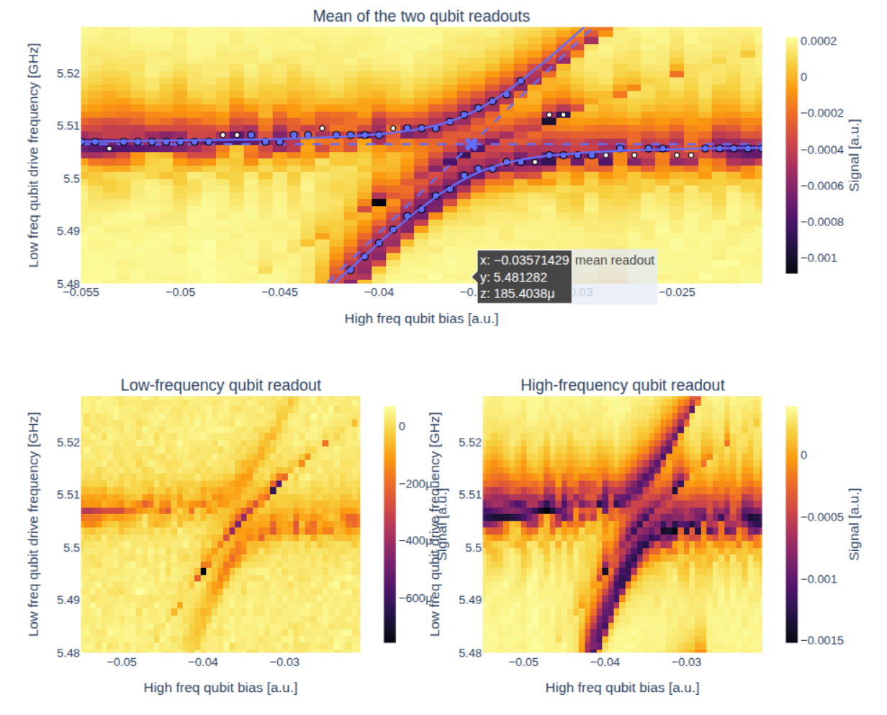

.. _avoided_crossing:

Avoided crossing
================

The ``avoided_crossing`` protocol measures the interaction between a pair of
qubits by bringing their transition frequencies into resonance. It estimates the
crossing bias and frequency, the qubit-qubit coupling, and the local slope of the
flux-tuned qubit frequency.

Experiment
----------

The protocol orders each target pair by its configured drive frequencies. A long
spectroscopy pulse drives the lower-frequency qubit while a flux pulse of the
same duration is applied to the higher-frequency qubit. Both qubits are then read
out using integrated I/Q acquisition.

The spectroscopy drive frequency and flux-pulse amplitude are swept to produce a
two-dimensional map for each readout. Here, ``bias`` means the flux-pulse
amplitude applied on top of the existing DC flux offset, not a change to the DC
offset itself. The higher-frequency qubit must have a flux channel.

Model
-----

Near a crossing, the driven qubit frequency is approximated by a constant
:math:`f_0`, and the bare frequency of the flux-tuned qubit by
:math:`f_0 + m(x-x_c)`. The coupled eigenfrequencies are

.. math::

   f_{\pm}(x) = f_0 + \frac{m(x-x_c)}{2}
       \pm \sqrt{\left[\frac{m(x-x_c)}{2}\right]^2 + g^2},

where :math:`x` is the flux-pulse amplitude, :math:`x_c` is the crossing bias,
:math:`m` is the bare-qubit slope, and :math:`g` is the coupling in Hz.

The reported crossing point :math:`(x_c, f_0)` is the intersection of the
*uncoupled* qubit frequencies. At this bias the coupled branches are at
:math:`f_0-g` and :math:`f_0+g`, so the minimum splitting is :math:`2g`, not
:math:`g`. Frequencies and coupling are expressed in Hz, not angular frequency.

Parameters
----------

.. autoclass:: qibocal.protocols.two_qubit_interaction.avoidedcrossing.AvoidedCrossingParameters
    :noindex:

``bias`` and ``frequency`` accept range specifications such as
``[start, stop, step]``. A frequency range can also be centered on the configured
drive frequency of the lower-frequency qubit using ``[center, width, step]``.
For example, ``[center, 100000000, 500000]`` sweeps a 100 MHz-wide window in
0.5 MHz steps.

Pulse durations and ``relaxation_time`` are in ns; pulse amplitudes are in
arbitrary units. ``nshots`` controls the number of shots at each sweep point.
Choose the bias and frequency ranges to include the crossing and enough of its
surrounding branches. Crossing detection requires at least seven bias samples
and five frequency samples.

Example
-------

The following action can be added to a :ref:`runcard`. Replace the target IDs and
adapt the pulse amplitudes and sweep ranges to the device.

.. code-block:: yaml

    - id: avoided crossing
      operation: avoided_crossing
      targets: [[0, 1]]
      update: false
      parameters:
        bias: [-0.1, 0.1, 0.001]
        frequency: [center, 100000000, 500000]
        pulse_duration: 4000
        pulse_amplitude: 0.01
        nshots: 1024
        relaxation_time: 50000

The example disables calibration updates so the spectroscopy maps can be
inspected first. Readout and drive frequencies should already be calibrated;
see :ref:`qubit-spectroscopy` and :ref:`flux` for related measurements.

Analysis
--------

Each readout's I/Q data are projected onto their first principal component. The
two projections are sign-aligned and averaged so that opposite readout responses
do not cancel.

Peak extraction is performed once on this mean map, retaining at most two
prominent peaks or dips per bias sample. These coordinates are used both for
crossing estimation and, when applicable, fitting:

* With two resolved branches, local minima of their separation identify crossing
  candidates. Their midpoint estimates the crossing frequency, half their gap
  estimates the coupling, and the derivative of their sum estimates the
  bare-qubit slope.
* When only the bright, qubit-like branch is visible, a sufficiently large
  frequency jump provides an approximate crossing estimate. The bias and
  frequency are estimated from the midpoint of the adjacent samples, and the
  coupling from half the jump.

All estimated crossings for a pair are assigned the median estimated frequency
and the median estimated coupling, while their individual biases and slopes are
retained.

If **exactly one crossing** is detected, a RANSAC fit refines the eigenbranch
model using the **entire extracted peak set across the bias sweep**, without
cropping to a local window. RANSAC generates candidate fits from random samples,
evaluates them against the full peak set, and refines the selected inliers.
If the fit fails, the initial estimate is retained.

If several crossings are detected, RANSAC is skipped and the estimates are
reported instead. If no crossing is detected, no crossing result or calibration
update is produced.

.. note::

    The fitted model assumes one locally linear flux-tuned qubit and one
    approximately constant-frequency qubit. A wide sweep with significant
    curvature or unrelated spectral features may not be described by this model.
    Estimates obtained from a single bright branch are approximate.

Report
------

The report contains one figure with the mean signal across the full-width top
panel and the two individual qubit signals side by side below it. The mean panel
shows the extracted peaks, estimated crossing points and asymptotes. When RANSAC
succeeds, it also shows the inlier peaks and fitted eigenbranches.

Legend entries independently toggle the extracted signal, each crossing with its
asymptotes, the RANSAC inliers, and the fitted hyperbolas. A table lists crossing
biases, frequencies in GHz, and couplings in MHz.

Calibration update
------------------

When updates are enabled globally and for the action, the protocol stores the
pair coupling in ``platform.calibration.two_qubits[pair].coupling`` as
``[coupling_in_hz, 0.0]``. The second entry is a placeholder because no coupling
uncertainty is estimated.

For a successful single-crossing fit, this is the fitted coupling. Otherwise,
when crossing estimates are available, it is their median coupling, which is
shared by all reported estimates. A failed RANSAC fit can therefore still update
calibration from its retained estimate. Set ``update: false`` to prevent this.
The protocol does not update drive frequencies, flux offsets or sweetspots.

Two-photon transition
---------------------

In addition to the two hyperbolic branches, the spectroscopy map often shows a
fainter curved line that crosses the avoided crossing. It is most intense close
to the crossing, where the hybridization of the two qubits is maximal, and fades
as the bias moves away and the eigenstates become more qubit-like.

This feature is the two-photon transition
:math:`|00\rangle \rightarrow |11\rangle`, in which the qubit pair absorbs two
drive photons and both qubits are excited. Its transition frequency is
approximately the sum of the two single-excitation frequencies, so the drive
resonates with it at about half of that value:

.. math::

   f_{\mathrm{2ph}}(x) \simeq \frac{f_{11}(x)}{2}
       \simeq \frac{f_{+}(x) + f_{-}(x)}{2} = f_0 + \frac{m(x-x_c)}{2}.

Notes on its behavior:

* Far from the crossing, a drive near :math:`f_{\mathrm{2ph}}` is off-resonant
  with both single-photon transitions, so the process is only weakly allowed.
  Close to the crossing, the dressed states share drive and flux-tuned
  character, which increases the matrix elements and therefore the intensity.
* The line is not expected to show an avoided crossing at :math:`x_c`: it lies
  midway between the two branches, with half the slope of the flux-tuned qubit.
  Deviations from a straight line, such as curvature, come from the
  nonlinearity of the flux dependence and from interactions with higher levels
  (for example :math:`|02\rangle` and :math:`|20\rangle`), which shift the
  :math:`|11\rangle` energy by a ZZ-like term.
* Being a two-photon process, its strength depends on the number of photons
  pumped into the system, which scales with the drive power. Lowering
  ``pulse_amplitude`` makes the transition, and its signal, fade and eventually
  disappear, while the single-photon branches remain. Conversely, a larger
  amplitude makes it more visible but also power-broadens the main branches.
  This power dependence is a simple way to confirm that a feature is the
  two-photon line.
* It can be used as a consistency check: the line should pass through
  :math:`(x_c, f_0)` and, together with the branch asymmetry, helps
  distinguishing true hybridization from unrelated spectral features.

.. note::

    This feature is not part of the fitted model. Because at most two peaks per
    bias sample are retained, a strong two-photon line can be extracted instead
    of a true branch and bias the crossing estimate. If this happens, lower
    ``pulse_amplitude`` or narrow the ``frequency`` window.
