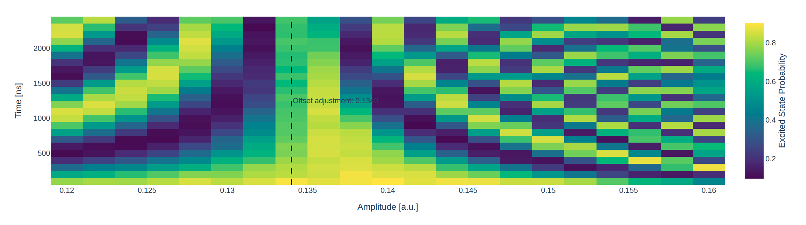

.. _coupler_ramsey_zz:

Coupler Ramsey
==============

The ``coupler_ramsey_zz`` protocol searches for the bias of a tunable coupler
that suppresses the residual interaction between two qubits. It performs a
conditional Ramsey experiment while sweeping the coupler flux-pulse amplitude
and the Ramsey waiting time.

The qubit drive frequencies must already be calibrated using :ref:`ramsey`.
Otherwise, ordinary drive detuning can produce Ramsey oscillations that are
indistinguishable from the frequency shift caused by the interaction.

Experiment
----------

Targets are ordered qubit pairs: the first qubit is the Ramsey target and the
second is the control. For each pair, Qibocal prepares the target with an
:math:`RX(\pi/2)` pulse and excites the control with an :math:`RX(\pi)` pulse.
After both preparation pulses finish, a rectangular flux pulse is applied to
the coupler for a waiting time :math:`\tau`. A second :math:`RX(\pi/2)` pulse
on the target closes the Ramsey sequence, and both qubits are measured.

The flux-pulse amplitude and duration are swept independently. At each coupler
bias, the target population oscillates with the frequency shift conditioned on
the excited control state. Near the nulling point, these oscillations are
suppressed. The control readout provides a diagnostic of whether the control
remains excited during the experiment.

Parameters
----------

.. autoclass:: qibocal.protocols.couplers.ramsey_zz.CouplerRamseyParameters
    :noindex:

Both ``delay_range`` and ``amplitude_coupler_range`` accept
``[start, stop, step]`` specifications. Delays are in nanoseconds and coupler
amplitudes are in arbitrary units. The amplitude range specifies pulse
amplitudes relative to the coupler's existing DC offset, not absolute biases.
``nshots`` sets the number of shots per sweep point, while ``relaxation_time``
sets the wait between shots in nanoseconds.

Example
-------

A possible action in a runcard is:

.. code-block:: yaml

    - id: coupler nulling point
      operation: coupler_ramsey_zz
      targets:
        - [0, 1]
      parameters:
        delay_range: [100, 2500, 100]
        amplitude_coupler_range: [-0.02, 0.022, 0.002]
        nshots: 1024
        relaxation_time: 20000

Here, qubit ``0`` is the Ramsey target and qubit ``1`` is the excited control.
The amplitude range should be chosen around the expected nulling bias, taking
the current coupler DC offset into account.

An example target-qubit heatmap is shown below:

    Ramsey fringes change with coupler bias. The dashed line marks the selected
    nulling point.

The report contains separate heatmaps of the target and control excited-state
probabilities as functions of the waiting time and the absolute coupler bias.
The latter is the sum of the swept pulse amplitude and the DC offset recorded
during acquisition.

Nulling-point estimation and updates
----------------------------------------

For each sampled bias :math:`b`, Qibocal computes the variance of the target
excited-state probability over the sampled delays:

.. math::

    b_{\mathrm{null}} =
    \operatorname*{arg\,min}_{b}
    \operatorname{Var}_{\tau}\left[P_{\mathrm{target}}(1 \mid b, \tau)\right].

The result is a sampled bias, not an interpolated optimum or a fitted ZZ rate.
The report marks this value on the target heatmap and lists it as the coupler
nulling point.

.. note::

    Minimum variance is a heuristic for suppressed Ramsey fringes, not an
    independent measurement of zero ZZ coupling. Decoherence, low contrast,
    or undersampling can also flatten a trace. Choose a delay range that
    resolves the fringes without losing contrast, inspect both heatmaps, and
    refine the amplitude sweep around the candidate bias if necessary.

When platform updates are enabled, the selected absolute bias replaces the
coupler's flux offset and its calibration ``sweetspot`` value. It is not added
to the existing offset again. Qubit flux offsets and sweetspots are unchanged.

Requirements
------------

- Calibrated single-qubit rotations: :ref:`rabi`.
- Calibrated qubit drive frequencies: :ref:`ramsey`.
- Single-shot readout discrimination for both qubits: :ref:`single-shot`.
- A coupler ID assigned to the pair in ``platform.calibration.two_qubits``,
  with a corresponding entry in ``platform.couplers`` and a configured flux
  channel.
