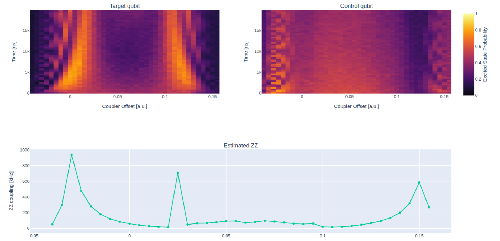

.. _coupler_jazz:

Coupler JAZZ
============

In architectures with tunable couplers the residual ZZ interaction :math:`\zeta`
between two neighboring qubits depends on the coupler bias. At a specific bias,
called the **nulling point**, the contributions of the direct qubit-qubit coupling
and of the coupler-mediated interaction cancel, hence the residual ZZ is minimized.

The ``coupler_jazz`` protocol locates this point by repeating the JAZZ
(Joint Amplification of ZZ) experiment described in
:doc:`../zz_interaction/zz_interaction` while sweeping the DC offset of the coupler
flux line. Targets are ``[target, control]`` qubit pairs; each pair must be linked
to a coupler in ``platform.calibration.two_qubits`` and the coupler must have a
flux channel.

Experiment
----------

For each coupler offset the following sequence is executed:

.. code-block:: text

    target:  RX90 -- tau -- RX -- tau -- RY90 -- MZ
    control:      -- tau -- RX -- tau --------- MZ
    coupler: DC offset held for the whole sequence

The simultaneous :math:`\pi` pulse on both qubits refocuses any unconditional
frequency shift of the target, including the one induced by the coupler bias,
while the conditional ZZ phase keeps accumulating over the whole echo.
The half-wait ``tau`` is swept through ``delays_settings``, whereas the coupler
offset is swept through ``coupler_offset_range``. A ``[start, stop, step]``
specification sweeps absolute offsets, while the ``center``, ``lincenter``,
``asym`` and ``linasym`` specifications are relative to the coupler offset currently
stored in the platform.
Both target and control populations are acquired.

Analysis
--------

For each coupler offset the target population is fitted with a damped sinusoid

.. math::

    P_{|1\rangle}(t) = c + A \, e^{-\gamma t} \sin(\omega t),

and the ZZ coupling is obtained from the oscillation frequency,
:math:`\zeta = \omega / 2\pi`. The initial frequency guess is computed with the
Quinn-Fernandes estimator. When ``fast_evaluation`` is enabled (default) the fit is
skipped and only this estimate is used: this is recommended for coarse scans,
since ZZ can vary strongly with the coupler bias and the oscillations may be
undersampled, making a full fit unreliable. Offsets for which the estimation fails
are logged and skipped.

The nulling point is selected as the offset minimizing the loss

.. math::

    L = w \, \tilde{\gamma} + \frac{1 - w}{2}\left(A + \left|c - \frac{1}{2}\right|\right),

where :math:`\tilde{\gamma}` is the min-max normalized decay rate across offsets
and :math:`w` is set by ``fit_weight``. The loss favors slow and flat signals
centered at :math:`P = 1/2`, as expected when no ZZ phase is accumulated.

The report shows the target and control population heatmaps versus coupler
offset and delay, with the nulling point marked by a red dashed line, together
with the estimated ZZ coupling as a function of the coupler offset.

If updates are enabled, the nulling point bias is set as the coupler flux offset
and stored as the coupler ``idle_bias``, and the residual ZZ at that point is
stored as the pair coupling.

Parameters
----------

.. autoclass:: qibocal.protocols.couplers.jazz.CouplerJAZZParameters
    :noindex:

Example
-------

.. code-block:: yaml

    - id: coupler jazz
      operation: coupler_jazz
      targets: [[0, 1]]
      update: false
      parameters:
        delays_settings: [16, 20000, 400]
        coupler_offset_range: [-0.05, 0.15, 0.005]
        fast_evaluation: true
        fit_weight: 0.5
        nshots: 1024
        relaxation_time: 50000

Requirements
------------

- :ref:`rabi`
- :ref:`ramsey`
