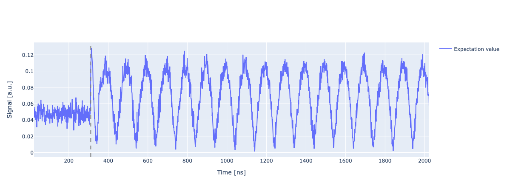

.. _Time Of Flight:

Time Of Flight (Readout)
========================

In this section, we present the time-of-flight experiment for qibocal (see Fig.12 :cite:p:`gao2021practical`).

In the `time of flight` experiment, we measure the time it takes for a readout pulse to travel to the qubit and back, being acquired by the control instrument ADCs.

Carefully calibrating this delay time is important to optimize the readout. In particular, it is useful to acquire just for the duration of the readout pulse, where differences between the two states really appear (both in amplitude and phase).

Parameters
^^^^^^^^^^

.. autoclass:: qibocal.protocols.signal_experiments.time_of_flight_readout.TimeOfFlightReadoutParameters
  :noindex:

How to execute the experiment
^^^^^^^^^^^^^^^^^^^^^^^^^^^^^

.. code-block:: yaml

    - id: time of flight experiment      # custom ID of the experiment
      operation: time_of_flight_readout  # unique name of the routine
      parameters:
        readout_amplitude: 0.5
        detuning: 50_000_000
        nshots: 1024
        relaxation_time: 20_000

Although it is possible to avoid setting a specific readout amplitude, it is generally useful to set a high value here. Indeed, we are not looking for the optimal amplitude but we want to have a signal with enough power so that it is clear when it starts.

Acquisition
^^^^^^^^^^^

A rectangular readout pulse of the given ``duration`` and ``readout_amplitude`` is
played at the LO frequency shifted by ``detuning``, and the raw ADC trace is acquired
for the same ``duration``. The returned pulse shows up as an oscillation at the detuning
frequency in the I and Q traces, which separates it from DC offsets and LO leakage and
makes its arrival easy to identify.

Fit
^^^

The fit works on the magnitude of the acquired trace, :math:`\sqrt{I^2 + Q^2}`, which is
flat before the pulse arrives and jumps to a higher level once it does.

The baseline level is estimated as the mean of the first window of the trace (before the
pulse arrives), and the signal level as the mean of the last window (after the pulse has
arrived). The window spans one period of the detuning frequency, so that any residual
oscillation at that frequency (due to imperfect I/Q balance) averages out. With the
default detuning of 20 MHz this corresponds to 50 ns.

A threshold is then set halfway between the baseline and signal levels, and the time of
flight is the time of the first sample whose magnitude exceeds this threshold.

Requirements
^^^^^^^^^^^^

Before this experiment, nothing in particular is required. This can indeed be done as a first test of the connections.
