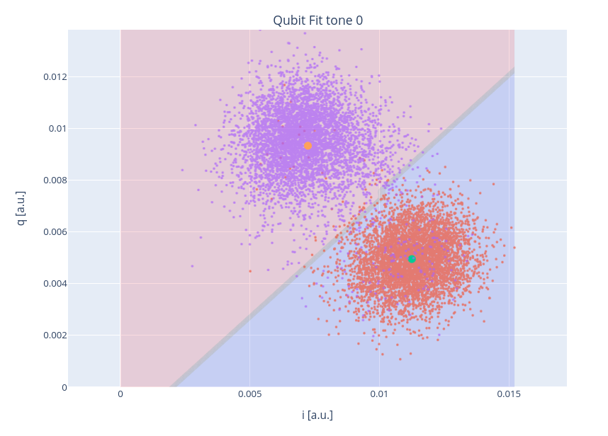

.. _single-shot:

Single Shot Experiments
=======================

In this section we describe the single single shot exepriments for qubit and qutrits.

Qubit Single Shot
-----------------

Acquisition
^^^^^^^^^^^

In this experiment, the qubit is preapared multiple times in state :math:`\ket{0}` and :math:`\ket{1}`,
for each shot the  `I` and `Q` values are acquired. According to the theory, if we take into account
the noise, for each state we should observe a Gaussian blob in the `IQ-plane`:cite:`Krantz_2019`.

Fit
^^^
The shots are classified by a linear classifier. It evaluates the axis which passes through
the centroids of the two clusters, and determines the optimal threshold that maximizes the
difference between the cumulative distributions of the projections along the axis. Predicting
the state of a new point involves determining its relative position to the threshold based on its
projection along the axis. Due to its small complexity, it has high interpretability, but it does
not evaluate the probabilities. All the acquired shots are used, both to fit the classifier and to
evaluate the fidelities.

The decision boundary is defined in terms of the `angle` :math:`\theta` and `threshold` coordinates. The first one is the angle in radians formed by
the line connecting the centers of the blobs and the I-axis. After performing the rotation with angle :math:`-\theta`, which aligns that line to the
I-axis, the `threshold` is the coordinate along the I-axis that maximizes the fidelity :cite:`gao2021practical`.

.. math::

	\mathcal{F} = 1 - \frac{1}{2} (P(0,1) + P(1,0))

where :math:`P(i,j)` is the probability of measuring the qubit in state `i` but prepeared in state `j`.

Parameters
^^^^^^^^^^

.. autoclass:: qibocal.protocols.classification.classification.SingleShotClassificationParameters
	:noindex:

Example
^^^^^^^

A possible choice of parameters is the following

.. code-block:: yaml

    - id: single shot classification
      operation: single_shot_classification
      parameters:
        nshots: 5000

the result should looks like this

Requirements
^^^^^^^^^^^^

- :ref:`rabi`
