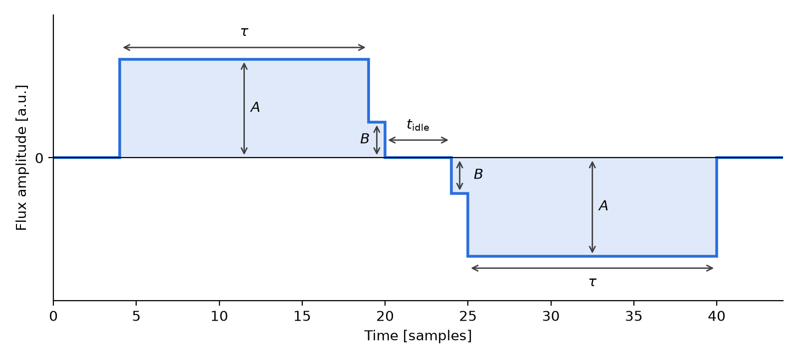
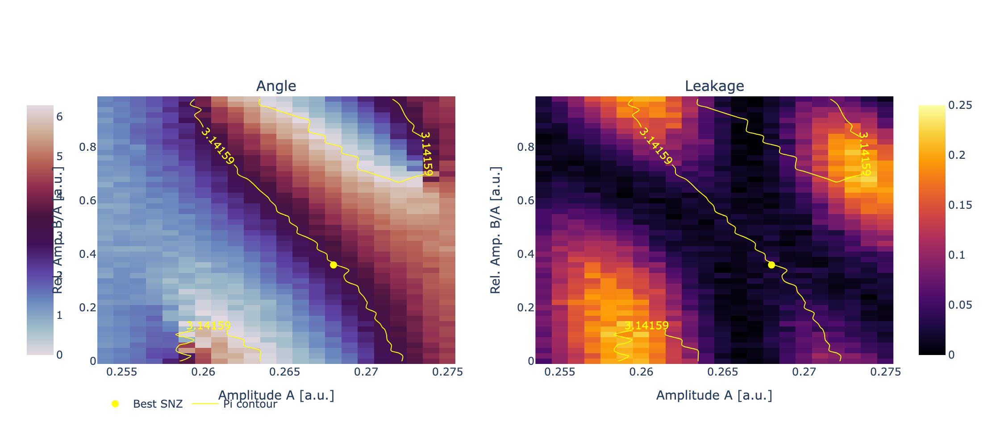
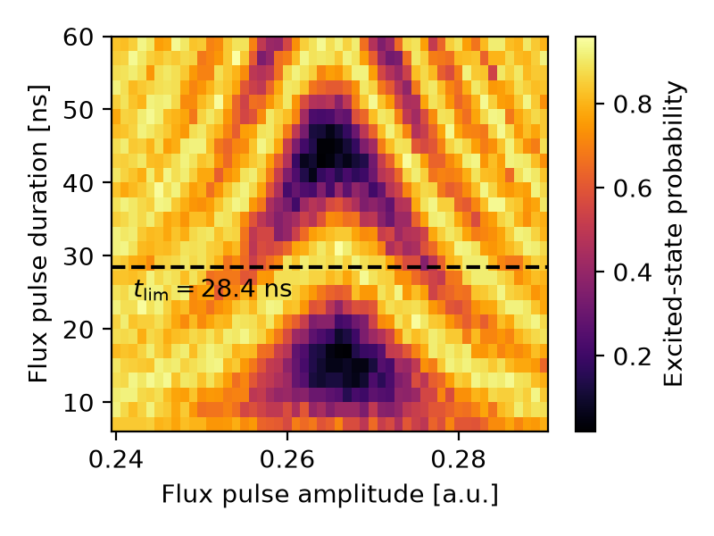

Sudden Net-Zero (SNZ) CZ gate
=============================

The Sudden Net-Zero (SNZ) pulse :cite:p:`SNZ_2021` implements a CZ gate between
two flux-tunable transmons. As in the Net-Zero scheme :cite:p:`NZ_2019`, two
square half-pulses of opposite sign (:math:`\pm A`) bring the pair to the
:math:`\ket{11} \leftrightarrow \ket{02}` avoided crossing, making the pulse robust
to long-timescale flux distortions. SNZ adds a single edge sample :math:`\pm B` to
each half and an idling time :math:`t_\text{idle}` between them.

The pulse shape is shown below for :math:`t_\text{idle} = 4` samples and
:math:`B/A = 0.36`. Each square half-pulse lasts :math:`\tau` samples, so that the
gate time is :math:`t_p = 2\tau + 2` samples and the total duration is
:math:`t_p + t_\text{idle}`.

Population leaked to :math:`\ket{02}` by the first half-pulse returns to
:math:`\ket{11}` during the second one if the relative phase accumulated in between is
right. Since :math:`t_\text{idle}` is discretized by the flux AWG sampling rate
:math:`t_s`, it changes this phase only in coarse steps of :math:`\Delta_{02} t_s`,
where :math:`\Delta_{02}` is the detuning of :math:`\ket{02}` during the idling
(typically :math:`\Delta_{02}/2\pi \sim` 0.5-1 GHz and :math:`t_s \sim` 1 ns). The
:math:`\pm B` samples provide the fine, continuous control.

The resulting landscape is regular: leakage shows a vertical valley in :math:`A`, at
the :math:`\ket{11}`-:math:`\ket{02}` resonance, and a diagonal one, and
:math:`\phi_{CZ} = \pi` is met where they cross. This is shown below for a measured
:math:`(A, B/A)` landscape, with the conditional phase (left), the leakage (right),
the :math:`\phi_{CZ} = \pi` contour and the selected point.

A good CZ is therefore found with a two-dimensional search, provided by two
protocols:

- ``snz_optimize`` sweeps :math:`A` and :math:`B/A` at fixed :math:`t_\text{idle}`;
- ``snz_optimize_t_idle`` sweeps :math:`A` and :math:`t_\text{idle}` at fixed
  :math:`B/A`.

At each grid point the :doc:`../virtual_z` experiment is run, with the control qubit
in :math:`\ket{0}` (``I``) or :math:`\ket{1}` (``X``). The conditional phase is the
phase difference of the two fitted oscillations, and the leakage is estimated as
half the increase of the control excited-state population from ``I`` to ``X``
:cite:p:`NZ_2019`. The selected point is the one with the lowest leakage among those
with :math:`\phi_{CZ}` within 10% of :math:`\pi`; if none exists, no update is
performed.

A typical workflow is :doc:`../chevron` to locate the
:math:`\ket{11} \leftrightarrow \ket{02}` interaction, then ``snz_optimize``, then
:doc:`../virtual_z` to calibrate the single-qubit phase corrections.

The gate time :math:`t_p` should not be shorter than the speed limit
:math:`t_\text{lim}`, the period of the on-resonance :doc:`../chevron` oscillation.
Below it, the minimum leakage at :math:`\phi_{CZ} = \pi` increases. An example of a
measured chevron, with the extracted :math:`t_\text{lim}`, is shown below.

.. note::

    The CZ native must contain a single flux pulse, on the higher-frequency qubit,
    as its first element, e.g. for the pair ``(2, 4)``:

    .. code-block:: json

        "4-2": {
          "CZ": [
            ["4/flux", {"kind": "pulse", "duration": 32.0, "amplitude": 0.268,
                        "envelope": {"kind": "snz", "t_idling": 4, "b_amplitude": 0.36}}]
          ]
        }

    Further elements (e.g. virtual Z phases) may follow and are left untouched.
    Flux pulses on both qubits, split flux pulses or tunable-coupler pulses are not
    supported.

SNZ amplitude optimization
--------------------------

Sweeps :math:`A` and :math:`B/A` at fixed :math:`t_\text{idle}` and :math:`t_p`.

.. autoclass::
    qibocal.protocols.two_qubit_interaction.snz_optimize.SNZFinetuningParamteters
    :noindex:

.. code-block:: yaml

    - id: snz_optimize
      operation: snz_optimize
      targets: [[2, 4]]
      parameters:
        amplitude_min: 0.254
        amplitude_max: 0.275
        amplitude_step: 0.001
        amp_ratio_min: 0.0
        amp_ratio_max: 1.0
        amp_ratio_step: 0.02
        theta_start: 0
        theta_end: 6.0
        theta_step: 1.0
        t_idling: 4
        tp: 32
        nshots: 100

The output is a landscape like the one shown above. The update sets the CZ flux
pulse to an SNZ envelope with the optimal ``amplitude`` and ``b_amplitude``.

SNZ idling time optimization
----------------------------

Sweeps :math:`A` and :math:`t_\text{idle}` (in samples) at fixed :math:`B/A` and
:math:`t_p`.

.. autoclass::
    qibocal.protocols.two_qubit_interaction.snz_optimize_t_idle.SNZIdlingParameters
    :noindex:

.. code-block:: yaml

    - id: snz_optimize_t_idle
      operation: snz_optimize_t_idle
      targets: [[2, 4]]
      parameters:
        amplitude_min: 0.254
        amplitude_max: 0.275
        amplitude_step: 0.001
        t_idle_min: 0
        t_idle_max: 10
        t_idle_step: 1
        b_amplitude: 0.36
        theta_start: 0
        theta_end: 6.0
        theta_step: 1.0
        tp: 32
        nshots: 100

The report has the same layout, with :math:`t_\text{idle}` (ns) on the y axis. The
update sets the optimal ``amplitude`` and ``t_idling``.
