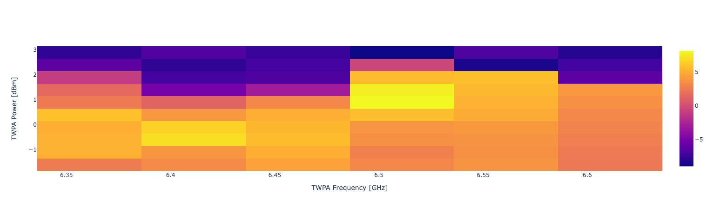

.. _twpa:

Calibration of TWPA
===================

In this section we show how to run an experiment aimed at calibrating the parameters
of an amplifier, which in most cases is going to be a TWPA.

In this experiment the pulse sequence consists in just a single readout pulse for each qubit.
We sweep the readout frequency and we acquire the signal. Firstly we acquire the signal
when the ampifier is off, then we repeat the same measurement by changing the frequency and
the power of the pump.

We then evaluate the gain for each frequency and power of the pump as :cite:p:`shin2024inoperandomicrowavescatteringparametercalibrated`

.. math::

    G(f, p) = 10 \log_{10} \Bigg( \frac{S_{on}(f, p)}{S_{off}} \Bigg)

where :math:`S_{on}(f,p)` is the signal acquired with the amplifier on and :math:`S_{off}`
the signal acquired with the amplifier off. The signal is defined as  :math:`S` as the average
magnitude of the signal for each readout frequency value.

The best point is then selected as the one with the maximum gain. Given that different qubits
often share the same amplifier, it could non trivial to select the best point.

Parameters
^^^^^^^^^^

.. autoclass:: qibocal.protocols.twpa.twpa.TwpaCalibrationParameters
  :noindex:

Example
^^^^^^^

A possible runcard to launch a TWPA calibration experiment could be the following:

.. code-block:: yaml

    - id: twpa_calibration
      operation: twpa_calibration
      parameters:
        freq_step: 10000000
        freq_width: 50000000
        nshots: 300
        twpa_freq_step: 50000000
        twpa_freq_width: 300000000
        twpa_pow_step: 0.5
        twpa_pow_width: 5

The expected output is the following:

TWPA Sweeper Protocol
---------------------

For instruments supporting hardware sweepers, the ``twpa_frequency_offset`` protocol
(aliased as ``twpa_sweep``) sweeps the TWPA pump frequency and amplitude (offset)
concurrently using an on-board 2D hardware sweep. Because hardware sweepers enforce
linear steps, the amplitude/power sweep is replaced by a linear offset sweep.
Offset values must lie in the inclusive interval [-1, 1].

Before sweeping the pump parameters, a reference scan measures the readout signal
with the TWPA pump off (its power lowered to ``PUMP_OFF_POWER``, or to the
``off_power`` parameter). The reference uses the same probe
frequencies, pulse duration, amplitude, and acquisition settings as the subsequent
pump sweep: one reference measurement per target at its calibrated readout frequency
by default, or one per target for each frequency listed in ``probes``.
The gain of each probe :math:`p` is computed with respect to its own reference

.. math::

    G_p(f, o) = 20 \log_{10} \frac{|IQ_{\mathrm{on}, p}(f, o)|}{|IQ_{\mathrm{off}, p}|},

where :math:`f` and :math:`o` are the pump frequency and offset. This reference
normalizes the amplified signal to the unamplified readout signal.

The probes' gains are then aggregated in a single map, as selected by the
``objective`` fit parameter:

- ``minimum`` (default): the minimum gain across the probes,
  :math:`\min_p G_p(f, o)`, i.e. the gain of the worst probe, which is the one limiting
  a multiplexed readout;
- ``average``: the ratio of the probe-averaged magnitudes,

  .. math::

      G(f, o) = 20 \log_{10} \left(
          \frac{\langle |IQ_{\mathrm{on}}(f, o)| \rangle_{\mathrm{probes}}}
               {\langle |IQ_{\mathrm{off}}| \rangle_{\mathrm{probes}}}
      \right),

  which is not the average of the probes' gains, and it is dominated by the probes
  with the largest signal.

With a single probe, the two coincide. The operating point maximizes the selected
map, over a neighbourhood of each point (cf. the ``neighbourhood`` fit parameter).
The report shows the selected map, and with several probes also the other aggregated
one, and the maps of each probe. The results table includes the gain of each probe
at the selected point.

The probes aggregated are all the ones amplified by the same TWPA pump, i.e. those of
all the targets sharing it. This is the case also when ``probes`` is omitted: the
readout frequencies of the targets on a pump are aggregated together, and a single
operating point is selected for the pump, and applied to all of them. The gain maps
are reported for the first of those targets only.

By default, when the ``probes`` parameter is omitted, the protocol performs only a
**single acquisition run** (a single execution for the reference scan, and a further
individual one for the 2D pump sweep). In this run, each target qubit is updated and
interrogated exclusively at its own calibrated readout resonator frequency, rather than
scanning across the readout frequencies of the other targets. This provides a fast,
multiplexed characterization at the operational frequencies of all selected targets.

When a discrete list of probe frequencies is provided in ``probes``, the protocol
instead evaluates each probe frequency in a loop, applying each frequency across all
target probe lines.
Gain computation raises an error if a target's TWPA-off reference magnitudes are
non-finite or close to zero, since they cannot provide a reliable normalization.

.. note::

    When defined, the probe frequencies are specified as a discrete list (``probes``) rather
    than a swept range, and evaluated via a software loop. The reason not to sweep the probe
    frequency continuously is that the TWPA gain oscillates rapidly with the probe frequency.
    Instead of obtaining the best gain on average across an arbitrary continuous range, the
    calibration is targeted specifically at the frequencies of the expected readout resonators.
    Because not all control electronics support sweeping an arbitrary non-equispaced list of values
    on-board, this is implemented as a loop over the probe frequencies, while the primary speed-up
    is achieved via the 2D hardware sweep over the pump signal parameters (amplitude and frequency).

Parameters
^^^^^^^^^^

.. autoclass:: qibocal.protocols.twpa.frequency_offset.TwpaFrequencyOffsetParameters
  :noindex:

Fit parameters, provided under ``fit_parameters`` in the runcard:

.. autoclass:: qibocal.protocols.twpa.frequency_offset.TwpaFrequencyOffsetFitParameters
  :noindex:

Example
^^^^^^^

.. code-block:: yaml

    - id: twpa_frequency_offset
      operation: twpa_frequency_offset
      parameters:
        probes: [7000000000, 7200000000]
        frequency: ["center", 300000000, 50000000]
        amplitude: [0.1, 0.5, 0.05]
        nshots: 300
      fit_parameters:
        objective: minimum
        neighbourhood: 1

TWPA protocols at a glance
--------------------------

The TWPA protocols are independent, since they trade the same measurement for
different costs. They share the plumbing of their acquisitions and figures, which lives
in :mod:`qibocal.protocols.twpa.utils`, but each has its own parameters, data and
results.

.. list-table::
   :header-rows: 1

   * - Protocol
     - Measures
     - Acquires
     - Use it to
   * - ``twpa_frequency_offset`` (``twpa_sweep``)
     - the gain over the pump frequency and offset
     - averages, computed on board
     - find the region and the point of largest gain, cheaply
   * - ``twpa_snr``
     - the SNR improvement and the added noise, over the same pump parameters
     - single shots, reduced in batches
     - compare points of similar gain, by what matters to the readout
   * - ``twpa_stability``
     - repeated references and signals at a single operating point
     - averages, computed on board
     - validate a selected point, and tell a drifting reference from a drifting pump

TWPA SNR Protocol
-----------------

The gain alone does not tell whether the readout improves: it ignores the noise added
by the amplifier, thus a point of larger gain may give a lower signal to noise ratio.
The ``twpa_snr`` protocol scans the same pump frequency and offset as ``twpa_sweep``,
with the same TWPA-off reference per probe, but it acquires the individual shots, to
know their spread. The SNR of a probe is the magnitude of its mean signal over the
spread :math:`\sigma` of its shots, the root mean square of the standard deviations of
the I and Q components, and the improvement with respect to the pump-off reference is

.. math::

    \Delta\mathrm{SNR}_p(f, o) = 20 \log_{10}
        \frac{|\mu_{\mathrm{on}, p}(f, o)| / \sigma_{\mathrm{on}, p}(f, o)}
             {|\mu_{\mathrm{off}, p}| / \sigma_{\mathrm{off}, p}}
        = G_p(f, o) - N_p(f, o),

i.e. the gain :math:`G_p` of ``twpa_sweep``, net of the noise added by the TWPA,
:math:`N_p = 20 \log_{10} (\sigma_{\mathrm{on}, p} / \sigma_{\mathrm{off}, p})`.
It needs no qubit calibration, since it only needs the readout resonator probed.

As in ``twpa_sweep``, the ``objective`` fit parameter selects the map optimized by the
fit, aggregated across the probes by their minimum: the SNR improvement (``snr``,
default) or the gain (``gain``). The report shows both maps, the SNR improvements of
each probe, and a table with the improvement, gain and added noise of each probe at the
selected point.

Single shots grow as ``nshots`` :math:`\times` offsets :math:`\times` frequencies
:math:`\times` probes, which easily exceeds the acquisition memory of the controllers.
Therefore:

- the pump offsets are split in batches, each holding at most ``max_values`` shots of a
  target, and covering all the pump frequencies;
- the shots are reduced to their mean and spread as soon as they are downloaded, and
  only these statistics are stored: ``(noffsets, nfrequencies, nprobes, 3)`` values,
  independently of ``nshots``;
- the reference is a single point, thus ``reference_shots`` may be larger than
  ``nshots``, to make it the least contribution to the uncertainty.

Another way to bound the cost is to run the scan on a small region only, selected with
``twpa_sweep``.

.. autoclass:: qibocal.protocols.twpa.snr.TwpaSnrParameters
  :noindex:

Fit parameters, provided under ``fit_parameters`` in the runcard:

.. autoclass:: qibocal.protocols.twpa.snr.TwpaSnrFitParameters
  :noindex:

.. code-block:: yaml

    - id: twpa_snr
      operation: twpa_snr
      parameters:
        frequency: ["center", 20000000, 1000000]
        amplitude: [0.6, 0.9, 0.025]
        nshots: 1000
        reference_shots: 20000
        max_values: 2000000
      fit_parameters:
        objective: snr
        neighbourhood: 1

TWPA Stability Protocol
-----------------------

The gain of a TWPA is measured against a reference with the pump off, taken along with
each scan. If that reference, or the pump, drifts between acquisitions, the very same
working point shows a different gain in every scan, even if the point selected is
reproducible. A scan of the pump parameters cannot tell: the map has the structure of
the amplifier, and its level the one of the drift.

The ``twpa_stability`` protocol validates a single operating point, as selected by
``twpa_sweep`` or ``twpa_snr``. It repeats ``repeats`` times the pair of acquisitions a
scan performs, the TWPA-off reference and the signal with the pump at the point
(``frequency`` and ``offset``, by default the configured pump), for each probe, and it
reports:

- the mean gain, and its standard deviation, with respect to the reference of each
  repetition, as a scan measures it;
- the standard deviation of the gain with respect to the mean reference of all the
  repetitions: if it is much smaller, the reference limits the stability of the gain,
  and not the pump;
- the standard deviations of the signals with the TWPA on and off, and their
  correlation, since signals moving together (e.g. a common drift of the readout chain)
  cancel in the gain.

The first figure compares the gain of each repetition with respect to its own and to
the common reference, and the second one the fluctuations of the signals with the TWPA
on and off. It does not update the platform.

.. autoclass:: qibocal.protocols.twpa.stability.TwpaStabilityParameters
  :noindex:

.. code-block:: yaml

    - id: twpa_stability
      operation: twpa_stability
      parameters:
        repeats: 20
        offset: 0.76
        frequency: 8279000000
        nshots: 400
