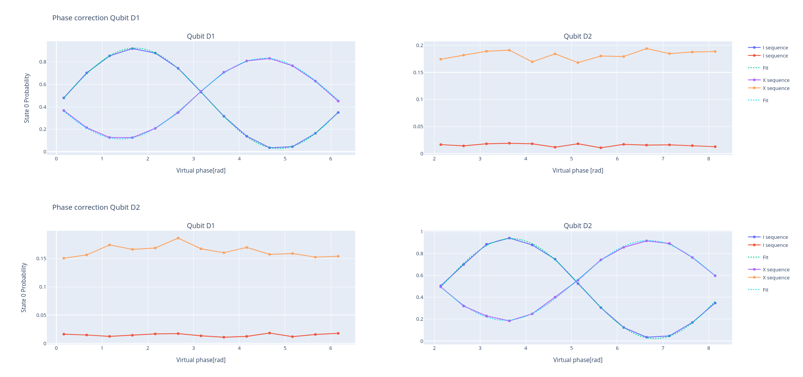

Virtual Z
=========

The protocol applies the native two-qubit gate (CZ or iSWAP) once and measures
conditional oscillations while sweeping the virtual Z phase.

For the iSWAP gate the excitation is exchanged between the two qubits: the
:math:`\pi/2` pulse is applied to the partner qubit, so that the gate transfers the
superposition onto the measured qubit. The fitted phase contains the :math:`\pi/2`
of the ideal iSWAP (:math:`|01\rangle \to i|10\rangle`), which is removed from the
virtual Z correction. The reported angle is the residual conditional phase on
:math:`|11\rangle`, which is 0 for an ideal iSWAP and cannot be corrected with
virtual Z rotations. Select the gate with ``native: iSWAP``.

Parameters
^^^^^^^^^^

.. autoclass::
	qibocal.protocols.two_qubit_interaction.virtual_z_phases.VirtualZPhasesParameters
	:noindex:

Example
^^^^^^^

Below is an example runcard for this experiment.

.. code-block:: yaml

     - id: cz
       operation: correct_virtual_z_phases
       parameters:
        dt: 0
        theta_end: 6.5
        theta_start: 0
        theta_step: 0.5

Alternatively, the sweep can be specified with ``theta``, which accepts any
:class:`qibocal.protocols.utils.RangeLike` and takes precedence over
``theta_start``, ``theta_end`` and ``theta_step``, e.g.
``theta: [linspace, 0, 6.28, 20]``.

The expected output is the following:

